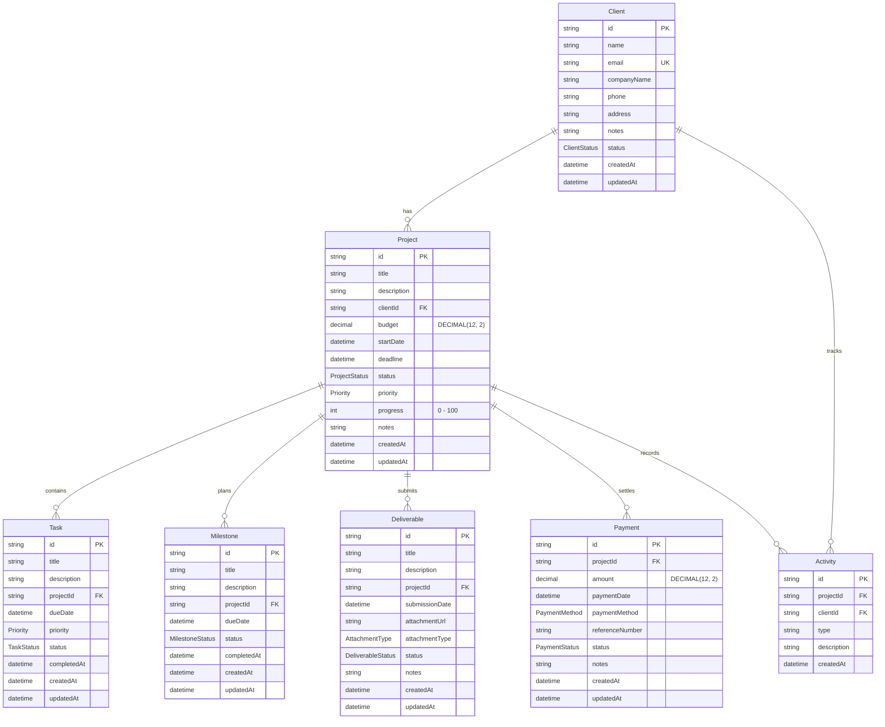

# FreelanceHub — Database Schema & Data Dictionary

This document details the relational architecture, entities, fields, enums, referential actions, and financial constraints in FreelanceHub.

---

## 1. Entity Relationship Diagram (ERD)

---

## 2. Enums Reference

| Enum Name | Allowed Values | Usage |
| :--- | :--- | :--- |
| `ClientStatus` | `ACTIVE`, `INACTIVE` | Lifecycle of client relationship |
| `ProjectStatus` | `PLANNING`, `IN_PROGRESS`, `ON_HOLD`, `COMPLETED`, `CANCELLED` | Sprint state of project |
| `Priority` | `LOW`, `MEDIUM`, `HIGH` | Urgency of tasks and projects |
| `TaskStatus` | `TODO`, `IN_PROGRESS`, `COMPLETED` | Execution progress of task |
| `MilestoneStatus` | `PENDING`, `IN_PROGRESS`, `COMPLETED` | Progress of milestone target |
| `DeliverableStatus`| `PENDING`, `SUBMITTED`, `APPROVED`, `REVISION_REQUIRED` | Client review workflow |
| `AttachmentType` | `FIGMA`, `GITHUB`, `DOCUMENT`, `ARCHIVE`, `EXTERNAL_LINK` | Handover asset type |
| `PaymentMethod` | `BANK_TRANSFER`, `UPI`, `CASH`, `OTHER` | Transaction settlement channel |
| `PaymentStatus` | `COMPLETED`, `PENDING`, `FAILED` | Financial settlement state |

---

## 3. Referential Actions & Data Integrity Rules

1. **Client Deletion Restrict:**
   `Client` $\rightarrow$ `Project` has `onDelete: Restrict`. A client with associated projects cannot be removed until those projects are reassigned or deleted.
2. **Payment Deletion Restrict:**
   `Project` $\rightarrow$ `Payment` has `onDelete: Restrict`. A project with recorded transactions cannot be deleted. This protects the freelancer's historical earnings audit trail.
3. **Cascade Cleanup:**
   When a project without payments is deleted, all dependent tasks, milestones, deliverables, and activity records are cleaned up automatically via `onDelete: Cascade`.

---

## 4. Financial Calculation Invariants

1. **Revenue Recognition:**
   $$\text{Total Paid} = \sum_{\text{status} = \text{'COMPLETED'}} \text{Payment.amount}$$
   Payments with status `PENDING` or `FAILED` are strictly excluded from all revenue totals.
2. **Outstanding Balance:**
   $$\text{Outstanding Balance} = \max\left(0, \text{Project.budget} - \text{Total Paid}\right)$$
3. **Overpayment Constraint:**
   A new payment cannot exceed the current outstanding balance:
   $$\text{New Payment Amount} \le \text{Outstanding Balance}$$
